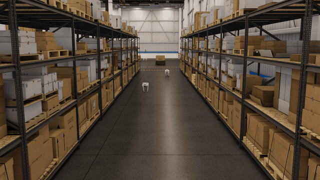

# isaac-warehouse-go2

Simulation of a warehouse with Unitree Go2 quadruped robots in Isaac Lab 3.0 and Isaac Sim 6.2, with navigation through ROS 2 Jazzy.



## Description

The scene is a warehouse of 50 by 40 metres assembled from 71 NVIDIA SimReady asset packages. It contains eleven rows of storage racks, a pallet staging area, a packing line with a conveyor, two forklifts, a pallet jack, a pallet stacker and ten walking workers.

Up to 21 Go2 robots walk with a locomotion policy trained in Isaac Lab. Twenty of them follow fixed patrol routes in the rack aisles, the north aisle and the staging yard. The remaining robot is controlled through ROS 2. The simulation publishes its odometry, its transforms and a planar laser scan. From these, slam_toolbox builds a map and Nav2 computes the velocity commands that drive the robot through a sequence of goals.

Vehicles and workers move along predefined paths. Vehicles stop for workers and for robots. Patrol robots follow the line of their route, stop for workers in their path and keep a distance of 1.3 metres to the robot ahead. The routes keep at least 0.9 metres between a lane and a line of building columns. When a robot falls, the runner detects the fall from the base height and orientation and places the robot upright at the position it occupied about 2.5 seconds earlier.

## Repository structure

| Path | Content |
|---|---|
| `assets.txt` | SimReady packages used in the scene |
| `probe_assets.py` | Reads the downloaded packages and writes `assets.json` with their bounds, variants and collider counts |
| `build_warehouse.py` | Writes the scene file and a layout file with robot routes, vehicle and worker paths, obstacle footprints and navigation goals |
| `run_warehouse.py` | Runs the simulation in Isaac Lab: robots with the locomotion policy, vehicles, workers, the ROS 2 interface and fall recovery |
| `run.sh` | Starts the runner with the ROS 2 environment and the selected GPU |
| `ros_env.sh` | Environment variables for the ROS 2 bridge included in Isaac Sim |
| `apps/` | Kit experience files that add the extensions the runner requires |
| `nav/` | Nav2 and slam_toolbox configuration, launch file, goal sequence and a scan check |
| `docker/Dockerfile` | ROS 2 Jazzy image with Nav2 and slam_toolbox |
| `tools/check_paths.py` | Checks robot, vehicle and worker paths against the scene geometry and reports paths that cross walls, pillars or racks or that pass closer than 0.45 metres to them for robots |

## Requirements

The simulation was developed on Ubuntu 24.04 with an NVIDIA L40S. A run with eight robots uses between 16 and 23 GB of GPU memory, so a GPU with at least 24 GB is recommended. It requires Isaac Lab 3.0 with Isaac Sim 6.2 and Docker with the NVIDIA Container Toolkit for the navigation stack. The NVIDIA driver installation must include the graphics libraries, because the compute-only driver packages do not provide the Vulkan support that Isaac Sim needs.

## Installation

1. Clone this repository:

   ```bash
   git clone https://github.com/prakash-aryan/isaac-warehouse-go2.git
   cd isaac-warehouse-go2
   ```

2. Clone Isaac Lab 3.0 and install it together with Isaac Sim:

   ```bash
   git clone --branch v3.0.0 https://github.com/isaac-sim/IsaacLab.git ~/IsaacLab
   cd ~/IsaacLab && uv sync --extra isaacsim && cd -
   ```

   The Python scripts of this repository use the USD modules of this environment and are run with `~/IsaacLab/.venv/bin/python` below.

3. Download the packages listed in `assets.txt` from the Hugging Face dataset `nvidia/simready-assets` and record their properties:

   ```bash
   while read -r p; do
     uvx --from huggingface_hub hf download nvidia/simready-assets --repo-type dataset --include "$p/*" --local-dir assets/simready
   done < assets.txt
   ~/IsaacLab/.venv/bin/python probe_assets.py assets/simready assets.txt assets.json
   ```

4. Place the worker assets in `assets/people`. The scene expects the character files in `Characters/` and a walking animation for each character in `baked/<character>_walk.usda`, for the characters `M_Construction_01`, `M_Medical_01`, `F_Business_02` and `F_Medical_01`. These files are not distributed with this repository.

5. Place a Go2 locomotion policy in `policies/go2_flat/model_1499.pt`. The policy used during development was trained in the Isaac Lab directory with the following command:

   ```bash
   ./isaaclab.sh -p scripts/reinforcement_learning/train.py --rl_library rsl_rl \
     --task Isaac-Velocity-Flat-UnitreeGo2 --num_envs 4096 --max_iterations 1500 --viz none --seed 2
   ```

6. Build the ROS 2 image:

   ```bash
   docker build -t jazzy-nav2 docker/
   ```

7. Build the scene:

   ```bash
   ~/IsaacLab/.venv/bin/python build_warehouse.py assets.json $PWD/warehouse.usda
   ```

`run.sh` expects Isaac Lab in `~/IsaacLab`. The variables `ISAACLAB_DIR`, `SIMREADY_DIR`, `PEOPLE_DIR` and `POLICY` override the default locations.

## Running the simulation

Start the simulation with eight robots and the ROS 2 interface:

```bash
./run.sh --robots 8 --ros --lidars hero --falls logs/falls.json
```

Start slam_toolbox and Nav2 in a container, then send the robot through the goal sequence:

```bash
docker run -d --name whnav --network host -u $(id -u):$(id -g) -e HOME=/tmp -e ROS_LOG_DIR=/tmp/roslog \
  -e ROS_DOMAIN_ID=42 -e RMW_IMPLEMENTATION=rmw_fastrtps_cpp -e FASTDDS_BUILTIN_TRANSPORTS=UDPv4 \
  -e NAV_PARAMS=/nav/params -v $PWD/nav:/nav -v $PWD:/wh jazzy-nav2 \
  bash -c "source /opt/ros/jazzy/setup.bash && python3 /nav/make_params.py /nav/params && exec ros2 launch /nav/slam_nav2.launch.py"
docker exec -d whnav bash -c "source /opt/ros/jazzy/setup.bash && cd /nav && \
  python3 -u nav_patrol.py --goals /wh/warehouse_goals.json --log /wh/nav_log.json > /wh/nav_patrol.log 2>&1"
```

The option `--robots` sets the number of robots (at most 21), `--steps` limits the length of the run and `--falls` writes every detected fall to a JSON file. `GPU` selects the device.

With eight robots and the ROS 2 interface, the simulation runs at about 15 environment steps per second on one L40S, which corresponds to 0.31 of real time. In repeated runs the navigating robot reached all seven goals of the sequence.

## Known limitations

The locomotion policy can fall during sharp turns at the corners of the patrol loops. The fall recovery keeps the simulation running, but the robot is moved back by about two metres. In a test run of 121 seconds with all 21 robots, every robot moved at 0.78 to 0.82 metres per second, no robot stayed in place for longer than a turn and no robot fell.

The laser scan used by Nav2 is computed by ray casting against the obstacle footprints of the scene. The RTX lidar sensor of Isaac Sim produced only partial sweeps in this configuration.

## Links

- Isaac Lab: [repository](https://github.com/isaac-sim/IsaacLab), [documentation](https://isaac-sim.github.io/IsaacLab/main/index.html)
- Isaac Sim: [product page](https://developer.nvidia.com/isaac/sim), [documentation](https://docs.isaacsim.omniverse.nvidia.com/latest/index.html)
- NVIDIA SimReady assets: [Hugging Face dataset](https://huggingface.co/datasets/nvidia/simready-assets)
- RSL-RL, the reinforcement learning library used for the locomotion policy: [repository](https://github.com/leggedrobotics/rsl_rl)
- Unitree Go2: [product page](https://www.unitree.com/go2)
- ROS 2 Jazzy: [documentation](https://docs.ros.org/en/jazzy/)
- Nav2: [documentation](https://docs.nav2.org/), [repository](https://github.com/ros-navigation/navigation2)
- slam_toolbox: [repository](https://github.com/SteveMacenski/slam_toolbox)
- NVIDIA Container Toolkit: [repository](https://github.com/NVIDIA/nvidia-container-toolkit)
